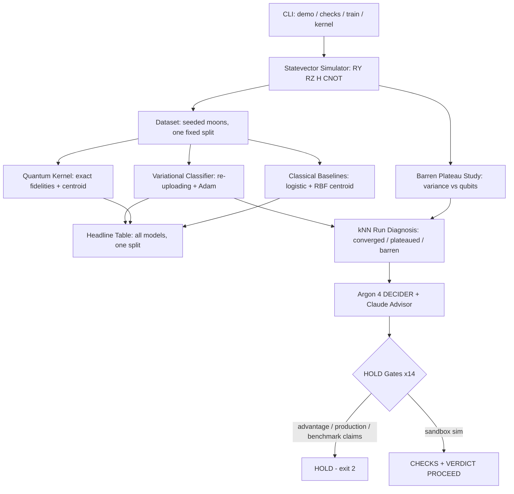
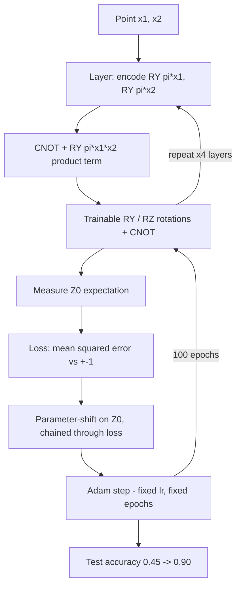
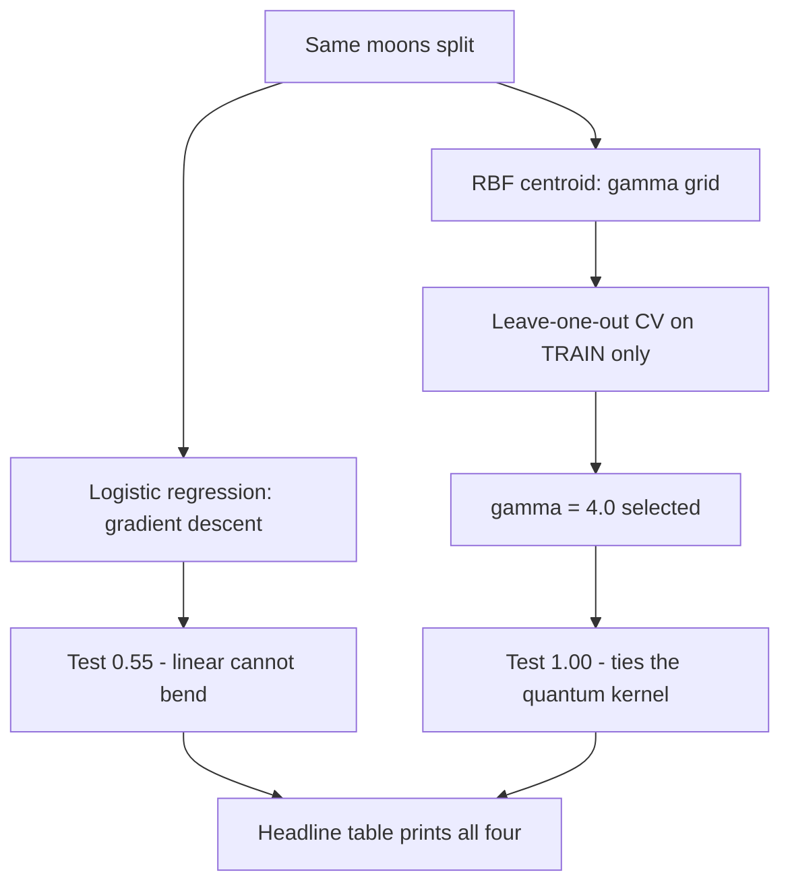
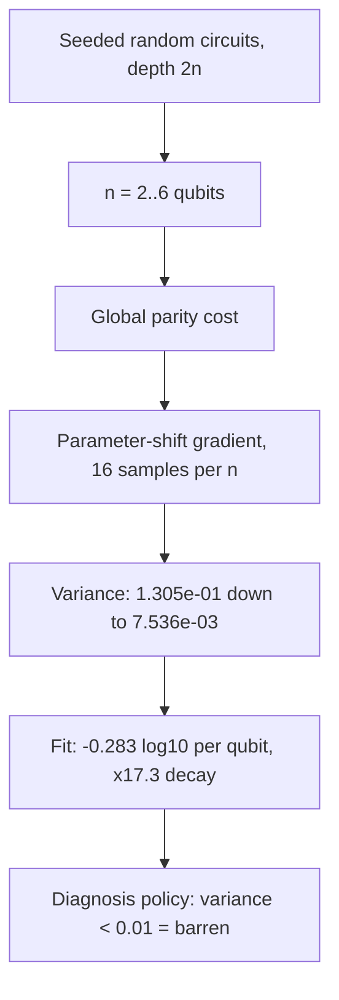
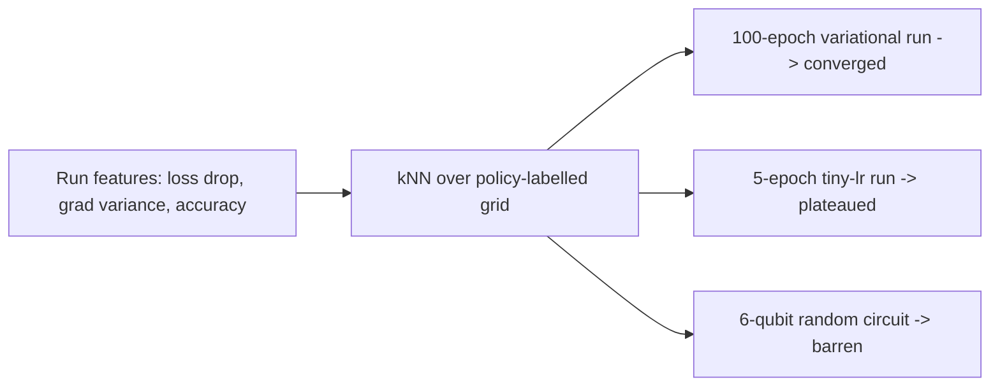
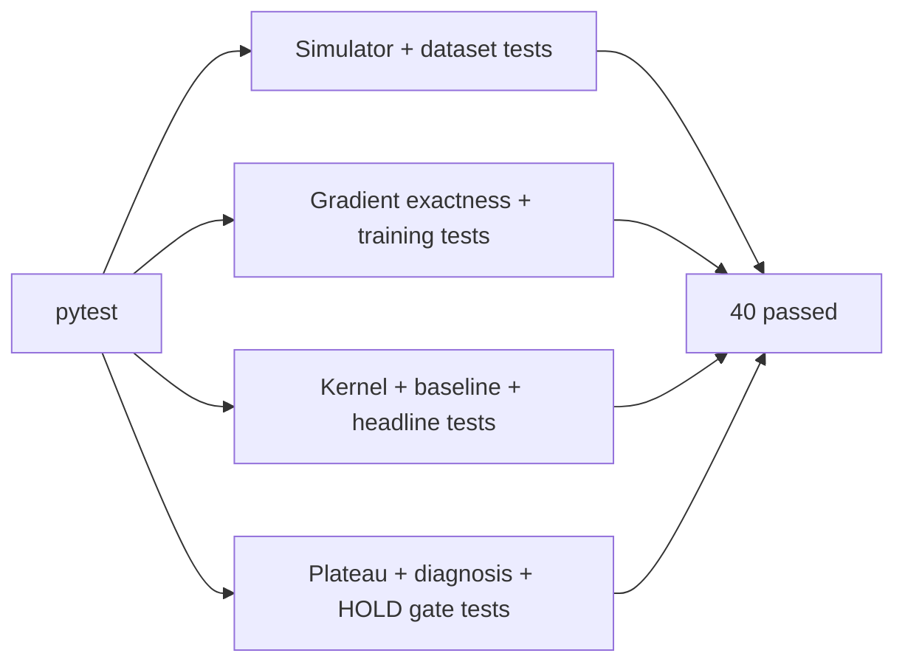
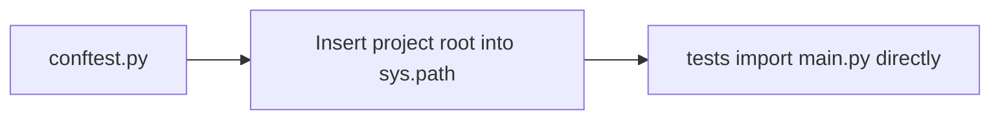
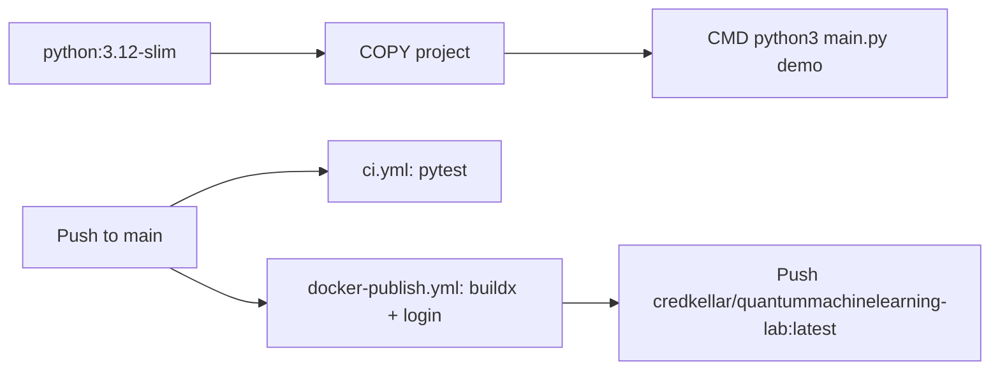

# QuantumMachineLearning-Lab 🤖⚛️

**Quantum Machine Learning Lab** — by Darion Kellar

QuantumMachineLearning-Lab is an **educational quantum machine learning lab** in ONE pure-Python file. It builds the real machinery of QML on a **from-scratch statevector simulator**: a **variational classifier** (2 qubits, data re-uploading, exact parameter-shift gradients, Adam) and a **quantum kernel classifier** (exact state fidelities, kernel-space nearest centroid) — both trained and graded on a small synthetic dataset of **two interleaving half-circles (moons)** generated in-lab with a fixed seed.

Then it does the thing QML demos usually skip: it trains **classical baselines in the same run, on the same split** — logistic regression by gradient descent, and an RBF-kernel centroid whose width is picked by leave-one-out cross-validation on the training split only. The headline table, measured:

| Model | Test accuracy |
|---|---|
| Variational circuit | 0.90 |
| Quantum kernel | 1.00 |
| **Classical RBF centroid** | **1.00** |
| Classical logistic regression | 0.55 |

The honest scope is the whole point, and it is stated everywhere:

- ✅ **What this lab teaches:** encodings, data re-uploading, exact gradients, fidelity kernels, kernel centroids, barren plateaus — the working parts of QML, each one computed and checkable.
- 🚫 **What it never claims:** quantum advantage. On this toy data the classical RBF baseline **ties the quantum kernel and beats the variational circuit** — and that result is printed in the headline, not buried. Everything is an exact classical simulation of tiny circuits; no quantum hardware is touched.

Every advantage / production / benchmark / deployment use sits behind a permanent HOLD gate (14 total). 🔒

[](https://github.com/kimanicollier44-cmyk/QuantumMachineLearning-Lab/actions/workflows/ci.yml)
[](https://github.com/kimanicollier44-cmyk/QuantumMachineLearning-Lab/actions/workflows/docker-publish.yml)

> ℹ️ These are the **live** workflow badges for this repo. They activate as soon as the `ci.yml` and `docker-publish.yml` files from the paste pack are pasted into `.github/workflows/` — until then they have nothing to report yet.

## 🧰 Tech Stack Badges & Full Architecture Tech Stack

### 💻 Core Programming Languages & Core Systems


- 🐍 Python 3.12, pure standard library (`math`, `random`, `hashlib`, `json`, `sys`) — zero dependencies, zero network, deterministic (double-run byte-identical)
- ⚛️ Statevector simulator from scratch: plain complex amplitudes, RY / RZ / Hadamard / CNOT by index arithmetic — no numpy, no quantum SDK, every operation visible and countable
- 🎯 Exact parameter-shift gradients: the shift rule is applied to ⟨Z₀⟩ and **chained through the squared loss** (shifting the loss directly would be wrong — the square adds a frequency-2 term; the checks prove the gradient against finite differences to < 1e-6)
- 🌕 Dataset generated in-lab: two interleaving half-circles, seed 20261118, σ = 0.08 noise, one fixed 40 / 20 train/test split shared by every model
- 🧠 TinyML kNN run-diagnosis classifier (from scratch, stdlib): converged / plateaued / barren from (loss drop, gradient variance, accuracy), labels generated by the lab's own diagnosis policy
- 🪑 Council seats: Gemini Argon 4 DECIDER (names-only, tighten-only) + Muse advisor (never overrides HOLD) + Google Flow plan-only (rendered = False, live = 0)

### ⛓️ Web3 & Infrastructure

- 🚫 **Not applicable — honestly.** No blockchain, no Web3, no tokens: the "infrastructure" here is a statevector simulator and a training loop inside one offline file. No fake badges here.

### ⚙️ Platform Support & Hardware Architecture


- 🖥️ Pure Python — runs anywhere Python 3.12+ runs (Linux, macOS, Windows), plus the `python:3.12-slim` Docker image
- 🔒 No quantum hardware is accessed, ever: every circuit is an exact classical simulation, and any hardware-execution claim is a permanent HOLD gate (see the gate table below)

### ⚡ Low-Level Infrastructure & Performance

- 🚫 **No low-level code — honestly.** No C, no C++, no GPU, no compiled extensions: one interpreted Python file on purpose, so every amplitude, gradient, and kernel entry can be read, checked, and diffed. Performance here means honest accounting — the simulator carries 2ⁿ amplitudes and the README says so; the plateau section measures what that scaling does to trainability.

### 🛠️ DevOps & Build Tools


- 🐳 Docker (`python:3.12-slim`), GitHub Actions CI + Docker Publish (delivered in the paste pack)
- 🎯 Target image: `credkellar/quantummachinelearning-lab:latest`
- 🧪 Tests: `pytest` (40 tests) + the built-in CHECKS suite (48 checks) in `main.py`

### ☁️ Cloud Providers

- 🚫 **None — honestly.** No cloud provider is used or needed: the lab runs fully offline on your own machine or in a local Docker container. Docker Hub appears only as the registry the publish workflow pushes the image to.

## What this does?

1. 🎛️ **Statevector simulator from scratch** — amplitudes as plain Python complex numbers; RY / RZ / Hadamard / CNOT applied by index arithmetic, with ⟨Z⟩ and global-parity ⟨Z…Z⟩ expectations. The Bell-state and parity checks pin the simulator to analytic values before any learning happens.
2. 🌕 **A dataset with a shape that matters** — two interleaving half-circles (moons), 60 points, seeded noise σ = 0.08, one deterministic 40 / 20 split. Moons are the classic shape a **linear model cannot separate** — which is exactly why kernels and circuits are interesting here, and why the linear baseline's 0.55 is information, not embarrassment.
3. 🔁 **Variational classifier with data re-uploading** — 2 qubits, 4 layers; each layer re-encodes the point (RY(πx₁), RY(πx₂), CNOT, RY(πx₁x₂)) and then applies trainable RY/RZ rotations. Prediction is sign(⟨Z₀⟩); the loss is mean squared error against ±1 labels.
4. 🎯 **Exact gradients, honestly derived** — the parameter-shift rule is exact for an expectation, so it is applied to ⟨Z₀⟩ and chained through the squared loss: ∂(z−y)² = 2(z−y)·∂z. Shifting the squared loss directly would silently drop a frequency-2 term — the lab does the chain step in the open and asserts agreement with finite differences to < 1e-6.
5. 🏃 **Training that is measured, not narrated** — Adam (lr 0.25, 100 epochs, seeded start) takes the loss **1.1777 → 0.2075** and test accuracy **0.45 → 0.90** (train 0.95). The start point is chance; the end point clears the lab's 0.85 bar — and still loses to a classical kernel, which is the next section's point.
6. 💎 **Quantum kernel, exact fidelities** — the encoding half of the circuit defines a feature map; K(x, x′) = |⟨φ(x)|φ(x′)⟩|² is computed from the statevectors themselves (K(x, x) = 1 asserted). A nearest-centroid classifier in kernel space scores **train 1.00 / test 1.00**.
7. ⚖️ **Classical baselines in the same run** — logistic regression by full-batch gradient descent (test **0.55** — moons beat linear models) and an RBF-kernel centroid whose γ is chosen by **leave-one-out cross-validation on the training split only** (γ = 4.0; the test split is never touched during selection): test **1.00**.
8. 🏆 **The headline table** — variational 0.90, quantum kernel 1.00, classical RBF 1.00, logistic 0.55. The classical kernel **ties** the quantum kernel and **beats** the variational circuit. `quantum_advantage_claimed` is a field in the report, and it is `False` — enforced by a check and a HOLD gate.
9. 🏜️ **Barren plateaus, measured** — random circuits (depth 2n, global parity cost) at 2–6 qubits: gradient variance falls **1.305e-01 → 7.536e-03**, a **×17.3 decay** with a fitted slope of **−0.283 log₁₀ per qubit**. The reason deep random circuits stop training is computed here, not quoted. (Companion measurement: VariationalQuantum-Lab.)
10. 🏷️ **Run-diagnosis classifier + seats + checks** — a from-scratch kNN labels training runs converged / plateaued / barren with labels from the lab's own policy: the 100-epoch run → **converged**, a 5-epoch tiny-lr run → **plateaued**, the 6-qubit random circuit → **barren**. Watched over by the Argon 4 DECIDER (sha256 trace), Muse advisor, Google Flow plan-only, and a built-in CHECKS suite (48 checks).

## 🗺️ How it works — diagram per script

### `main.py` — the whole lab



### `main.py` § variational classifier — re-uploading + exact gradients



### `main.py` § quantum kernel — fidelity + centroid

```mermaid
flowchart LR
    A[Point x] --> B[Feature map: angles + CNOT + product]
    B --> C[State phi of x]
    D[Point x'] --> E[Feature map]
    E --> F[State phi of x']
    C --> G[K = |inner product|^2]
    F --> G
    G --> H[Kernel distance to each class centroid]
    H --> I[Nearest centroid wins - test 1.00]
```

### `main.py` § classical baselines — the honest comparison



### `main.py` § barren plateaus — measured decay



### `main.py` § run diagnosis — kNN over the lab's own runs



### `tests/test_main.py` — verification



### `conftest.py` — test path setup



### `Dockerfile` + CI flow — container & publish



## Why is this cool?

1. ⚖️ The headline table is **an honesty device**: four models, one split, and the classical kernel ties the quantum one — printed at the top, enforced by a check, protected by a HOLD gate.
2. 🎯 The gradient is **exact and the derivation is shown**: parameter-shift applied to the expectation and chained through the loss, with the frequency-2 trap named — most tutorials silently get this wrong.
3. 🔁 **Data re-uploading** is implemented, not name-dropped: the point is re-encoded in all 4 layers, which is what lets a 2-qubit circuit carve a curved boundary at all.
4. 💎 The quantum kernel is **computed from the statevectors** — K(x, x) = 1 and symmetry are asserted, so the "kernel trick" here is arithmetic you can audit, not a library call.
5. 🧪 The classical baseline is **fair, not a strawman**: γ is picked by cross-validation on the training split only — the same discipline you'd demand of any ML experiment, applied to the lab's own comparison.
6. 🏜️ Barren plateaus are **measured on the bench**: ×17.3 gradient-variance decay across 2–6 qubits with a fitted slope — the field's central training problem, reproduced in one file.
7. 🩺 The run-diagnosis kNN closes the loop: the lab **grades its own training runs** (converged / plateaued / barren) with a policy whose barren line sits between its own measured points.
8. 🌕 Moons are the right toy: a shape where linear fails (0.55), kernels shine (1.00), and a variational circuit lands honestly in between (0.90) — three lessons in one dataset.
9. 🕐 Deterministic end to end: seeded data, seeded start, fixed schedule — run it twice, get byte-identical output, diff the training like code.
10. 🚫 The proudest field in the report is `quantum_advantage_claimed: False` — a QML lab that refuses to oversell is the one worth learning from.

## What problems this solves?

1. ❌ **Problem:** QML demos that never show a classical baseline. ✅ **Solution:** Two classical baselines train in the same run on the same split, and their scores headline the README next to the quantum models.
2. ❌ **Problem:** "Quantum advantage" implied by toy results. ✅ **Solution:** The measured result is a tie (kernels) and a classical win (over the variational circuit); advantage claims are a permanent HOLD gate.
3. ❌ **Problem:** Parameter-shift gradients applied to squared losses without the chain rule. ✅ **Solution:** The shift is applied to ⟨Z₀⟩ and chained through the loss in the open, and the checks assert the gradient against finite differences to < 1e-6.
4. ❌ **Problem:** Baselines tuned on the test set to win or lose on purpose. ✅ **Solution:** The RBF width is selected by leave-one-out CV on the training split only; the selection rule is stated and checked.
5. ❌ **Problem:** Barren plateaus invoked as a vibe. ✅ **Solution:** Gradient variance is measured at 2–6 qubits on seeded random circuits, with the decay factor and fitted slope printed.
6. ❌ **Problem:** Training runs reported as loss curves with no verdict. ✅ **Solution:** A policy + kNN diagnosis labels runs converged / plateaued / barren from measured features — including the lab's own stalled control run.
7. ❌ **Problem:** QML stacks that need an SDK, a cloud account, and a queue. ✅ **Solution:** One offline Python file; the simulator, both quantum models, both baselines, and the plateau study run locally with zero dependencies.
8. ❌ **Problem:** Toy datasets chosen so the quantum model can't lose. ✅ **Solution:** Moons are a shape where a tuned classical kernel is genuinely strong — the comparison can hurt, and here it does (variational 0.90 < RBF 1.00).
9. ❌ **Problem:** "It ran on a quantum computer" fog around simulations. ✅ **Solution:** The lab states it is an exact classical simulation everywhere, and `hardware_execution_claim` is a HOLD gate.
10. ❌ **Problem:** Non-reproducible ML demos. ✅ **Solution:** Seeded data generation, seeded parameter init, fixed optimizer schedule — double-run output is byte-identical and asserted.

## How to install this?

1. 📋 Clone or download this project folder:

```bash
git clone https://github.com/kimanicollier44-cmyk/QuantumMachineLearning-Lab.git
```

2. 🐍 Make sure Python 3.12+ is installed: `python3 --version`
3. ▶️ Run the full demo + checks (no arguments needed):

```bash
python3 main.py
```

4. 🧪 Run the test suite:

```bash
pip install pytest
python3 -m pytest -q
```

5. 🎛️ Try the other commands:

```bash
python3 main.py checks    # 48 built-in checks
python3 main.py data      # dataset report (seed, split, class counts)
python3 main.py train     # variational run: loss curve endpoints + accuracies
python3 main.py kernel    # quantum kernel report
python3 main.py baseline  # classical baselines: logistic + RBF centroid (CV)
python3 main.py headline  # all four models, one split, one table
python3 main.py plateau   # measured gradient variances + decay fit
python3 main.py classify  # kNN run-diagnosis report
python3 main.py brains    # Argon 4 + Muse + Flow seats
python3 main.py holds     # list all 14 HOLD gates
python3 main.py hold-demo # exits 2 - gated actions stay HOLD
```

6. 🐳 Or run it in Docker:

```bash
docker pull credkellar/quantummachinelearning-lab:latest
docker run --rm credkellar/quantummachinelearning-lab:latest
```

## Requirements

- 🐍 Python 3.12 or newer
- 📦 Dependencies: **none** (standard library only)
- 🌐 Network: **none** — fully offline
- 🧪 For tests only: `pytest`
- 🐳 Optional: Docker

## FULL project structure tree

```text
quantummachinelearning-lab/
├── main.py                  # the whole lab: simulator, moons dataset, variational classifier, quantum kernel, classical baselines, plateau study, diagnosis classifier, seats, HOLD gates
├── conftest.py              # puts the project root on sys.path for tests
├── tests/
│   └── test_main.py         # 40 pytest tests: simulator, dataset, gradients, training, kernel, baselines, plateaus, diagnosis, gates, seats
├── assets/
│   └── cover.png            # README cover image (2736 x 912)
├── .github/
│   └── workflows/
│       ├── ci.yml           # paste-in from the workflow pack
│       └── docker-publish.yml # paste-in from the workflow pack (tag: credkellar/quantummachinelearning-lab:latest)
├── Dockerfile               # python:3.12-slim, runs the demo
├── .gitignore               # __pycache__/, .pytest_cache/, *.pyc
└── README.md                # this file
```

> 📦 Delivered separately as paste packs (not in this tree): `.github/workflows/ci.yml` + `docker-publish.yml`, and the Docker Hub pack (100-char description, 350-char About, overview, categories).

## 🔒 HOLD gates — all 14, permanent

| # | Gate | What stays held |
|---|------|-----------------|
| 1 | `quantum_advantage_claim` | No quantum advantage claim; the classical baseline ties or beats the quantum models in this lab's own headline table |
| 2 | `production_ml_system_claim` | No claim this toy lab is a production machine-learning system |
| 3 | `benchmark_superiority_claim` | No benchmark superiority claims against real models, libraries, or hardware |
| 4 | `speedup_guarantee_claim` | No guaranteed speedup; the simulation itself costs 2ⁿ amplitudes and says so |
| 5 | `hardware_execution_claim` | No claim any result ran on real quantum hardware; everything is exact classical simulation |
| 6 | `real_dataset_training` | No training on real, personal, or sensitive datasets; the lab's data is synthetic and seeded |
| 7 | `medical_diagnosis_claim` | No medical diagnosis, screening, or health prediction use |
| 8 | `financial_prediction_claim` | No financial prediction, trading signal, credit, or insurance scoring use |
| 9 | `drug_discovery_claim` | No drug, molecule, or materials discovery claim from a toy classifier |
| 10 | `biometric_identification_use` | No face, voice, gait, or other biometric identification use |
| 11 | `autonomous_decision_system` | No deploying this lab as an automated decision-maker affecting real people |
| 12 | `defense_targeting_use` | No defence, targeting, surveillance, or weapons use |
| 13 | `cryptography_breaking_claim` | No claim of breaking, weakening, or evaluating real cryptography |
| 14 | `certified_ai_system_claim` | No claim of certification, audit, or regulatory approval for any AI system |

🧑‍⚖️ **Council seats:** Gemini Argon 4 Extended Thinking — DECIDER (names-only, tighten-only, MAP → MODEL → STRESS → DECIDE, sha256 trace, `can_override_hold = False`) · Muse — advisor (`can_override_hold = False`) · Google Flow — plan-only (`rendered = False`, `live = 0`).

✅ **Verification:** pytest **40 passed** (project + clean copy) · built-in CHECKS **48/48** · double-run output **byte-identical** · `hold-demo` exits **2** · `main.py` **941 lines**, pure stdlib, zero network.

## 🧒 5th-grade English section

Imagine you have to sort two curvy ribbons of dots — one ribbon bends like a smile, the other like a frown, and they are tangled together. A straight fence can't separate them. You need a fence that **curves**. 🌙

- **This lab teaches a tiny quantum computer to draw the curvy fence.** The quantum computer here is pretend — it lives inside a normal computer program — but the math it practices is the real math real quantum machines use. 💻
- One student is a **circuit** that keeps looking at each dot, guessing, fixing its mistakes, and guessing again — like practicing a dance 100 times until the steps get good. It ends up sorting **90 out of 100** test dots right. 💃
- Another student uses a **similarity trick**: it asks "which group does this new dot resemble most?" It gets **every test dot right**. 🎯
- But here is the honest part, and it is the most important part: a **regular, non-quantum student** using the same similarity trick *also* gets every test dot right. **Nobody won.** The quantum students did not beat the regular student — and this lab says so in big letters, because science is about what's true, not what's flashy. 🤝
- The lab also shows why teaching *bigger* quantum machines is hard: as you add parts, the "which way do I fix my mistake?" arrows shrink smaller and smaller, like whispers in a big room, until the student can't hear them at all. Scientists call that a **barren plateau** — and this lab measures the whispers getting quieter. 🤫
- This project is a **pretend lab on a computer**. It does not run on a real quantum machine and it does not beat real programs. It helps you learn how quantum learning works — honestly. 🔬

---

MIT © 2026 Darion Kellar · QuantumMachineLearning-Lab — educational simulation only 🤖
